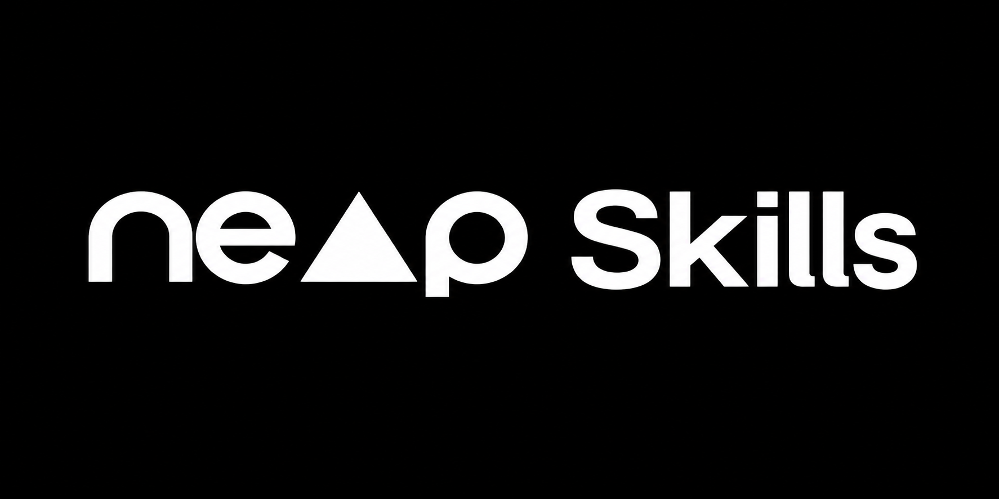

# Neop Skills (`neop-skills`)

Core AI agent skills for the **Neop** stack (Frontend Vue 3 + Website Strapi 5 / Nuxt 4 + Backend Laravel `neop-ba` + Daily Sync).

## Included Neop Skills

| Skill | Path | Purpose | Triggers |
|-------|------|---------|----------|
| **Neoper** | `.agents/skills/neoper` | Frontend module builder (`client/` & `super-admin/`): types, enums, `createService`, Zod schemas, composables (`useTable`, `useForm`), views, RBAC, and i18n. | `"neoper"`, `"new module"`, `"build module"` |
| **Neoper Website** | `.agents/skills/neoper-website` | Marketing website builder (`website/strapi` + `website/nuxt`): Strapi v5 Dynamic Zones (zero raw JSON), deep populate middlewares, bilingual EN/AR seeders, MD5 media uploads, 100/100 SEO + JSON-LD Schema, Nuxt 4 sections, and `[deploy] [seed]` CI. | `"neoper-website"`, `"website"`, `"strapi"`, `"seeder"`, `"dynamic zone"` |
| **Neoper Backend** | `.agents/skills/neoper-backend` | Backend architecture guide (`neop-ba` Laravel 12): `BaseCrudController`, `BaseCrudService`, `BaseResource` scopes, `BaseRequest`, DTOs, and `int`-backed enums. | `"neoper-backend"`, `"neop-ba"`, backend tasks |
| **Neoper Fodooly** | `.agents/skills/neoper-fodooly` | Daily git digest & sync tracker using `bk` (`seen/`) and `fr` (`client/` + `super-admin/`) shorthands; translates backend commits into frontend tasks and vice versa. | `"fodooly"`, `"neoper-fodooly"`, `"bk"`, `"fr"` |

## Curated External Skills (`skills.txt`)

[`skills.txt`](./skills.txt) includes the curated Frontend (Vue 3, Pinia, shadcn-vue, TanStack Query, Zod, Tailwind, Vite/Nuxt, GSAP, Anti-Slop UI, A11y/CWV/SEO) and Backend (Laravel Patterns, Laravel Specialist, PHP Pro) skills with their best usage notes.

- **Automatic runner fallback**: Runs with `bunx` first; if `bunx` is not found, automatically falls back to `bun x`, and then `npx -y`.

## Install or Update Skills

Run from your project root. Each command clones `neop-skills`, replaces any existing bundled skills in `.agents/skills/`, runs all commands in `skills.txt` (`bunx` → `bun x` → `npx -y`), and cleans up the temporary clone.

### Linux / macOS (Bash / Zsh)

```bash
rm -rf .tmp-neop-skills && git clone --depth 1 https://github.com/neop-planet/neop-skills.git .tmp-neop-skills && mkdir -p .agents/skills && for d in .tmp-neop-skills/.agents/skills/*; do [ -d "$d" ] && rm -rf ".agents/skills/$(basename "$d")" && mv "$d" .agents/skills/; done && { command -v bunx >/dev/null 2>&1 || bunx() { if command -v bun >/dev/null 2>&1; then bun x "$@"; else npx -y "$@"; fi; }; } && while IFS= read -r cmd || [ -n "$cmd" ]; do case "$cmd" in ''|\#*) continue ;; *) eval "$cmd" < /dev/null ;; esac; done < .tmp-neop-skills/skills.txt && rm -rf .tmp-neop-skills
```

### Windows (PowerShell)

```powershell
Remove-Item -Recurse -Force .tmp-neop-skills -ErrorAction SilentlyContinue; git clone --depth 1 https://github.com/neop-planet/neop-skills.git .tmp-neop-skills; New-Item -ItemType Directory -Force -Path .agents/skills | Out-Null; Get-ChildItem -Directory .tmp-neop-skills/.agents/skills | ForEach-Object { Remove-Item -Recurse -Force ".agents/skills/$($_.Name)" -ErrorAction SilentlyContinue; Move-Item -Force $_.FullName .agents/skills/ }; if (-not (Get-Command bunx -ErrorAction SilentlyContinue)) { function bunx { if (Get-Command bun -ErrorAction SilentlyContinue) { bun x @args } else { npx -y @args } } }; Get-Content .tmp-neop-skills/skills.txt | Where-Object { $_ -notmatch '^\s*(#|$)' } | ForEach-Object { Invoke-Expression $_ }; Remove-Item -Recurse -Force .tmp-neop-skills
```
